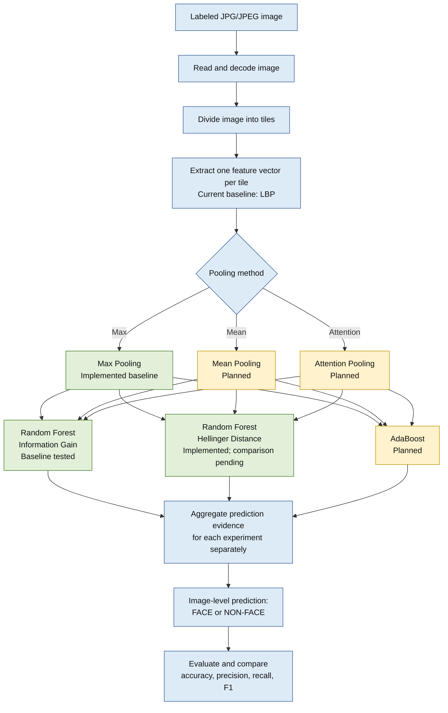

# Face and Non-Face Identification Based on Partial Image Regions Using Different Methods and Classifiers

This is the Software Project Lab 1 project described in the 2026 proposal. It aims to classify JPG/JPEG images as FACE or NON-FACE by analyzing local image regions, then combining the evidence to make an image-level prediction.

## Pipeline chart



Run each pooling/classifier configuration as a separate experiment. Information Gain and Hellinger Distance are separate Random Forest split-criterion variants. Testing all three pooling methods with both Random Forest variants and AdaBoost gives nine configurations. Green marks implemented components; yellow marks planned components.

## Project goals

The planned system will:

1. Read a JPG/JPEG image and divide it into smaller tiles.
2. Extract a numerical feature vector from each tile.
3. Compare Max Pooling, Mean Pooling, and Attention Pooling.
4. Classify pooled representations with two separately implemented classifiers:
   - Random Forest, investigating Information Gain and Hellinger Distance for tree splits.
   - AdaBoost, using sequentially trained weak learners.
5. Aggregate local-region or classification evidence into one image-level FACE/NON-FACE prediction.
6. Compare the pooling and classifier combinations using test-set metrics.

The comparison tests three pooling methods with three classifier configurations: Random Forest using Information Gain, Random Forest using Hellinger Distance, and AdaBoost. This gives nine configurations if each combination is run:

| Pooling method | Random Forest (Information Gain) | Random Forest (Hellinger) | AdaBoost |
|---|---|---|---|
| Max Pooling | Implemented baseline | Implemented; comparison pending | Planned |
| Mean Pooling | Planned | Planned | Planned |
| Attention Pooling | Planned | Planned | Planned |

## Implementation rules

- The project is written in C++.
- OpenCV and general-purpose machine-learning libraries are not used.
- Image tiling, pooling, attention, decision-tree operations, Information Gain, Hellinger Distance, Random Forest, AdaBoost, and prediction aggregation are intended to be implemented directly in C++.
- The proposal permits an approved external tool for feature extraction only.

## Current implementation status

The current working baseline implements this part of the project:

```text
JPG/JPEG -> grayscale -> non-overlapping tiles -> LBP per tile
         -> Max Pooling -> Random Forest -> FACE/NON-FACE
```

- Windows GDI+ currently decodes JPG/JPEG files. It is a Windows system dependency, not OpenCV.
- Tiles are 64 by 64 pixels by default. Smaller edge tiles are retained.
- LBP is currently calculated directly in C++ as a normalized 256-bin histogram for each tile.
- Max Pooling combines the tile histograms into one 256-value vector per image.
- The Random Forest is implemented in C++ and supports Information Gain, Gini, and Hellinger split criteria. Information Gain is the default.
- Training, prediction, feature export, and evaluation commands are available.

### Decisions to confirm before the final version

- The proposal says to use a permitted external feature-extraction tool. The current baseline calculates LBP manually. Confirm with the supervisor whether manual LBP is acceptable or whether an approved feature-extraction tool is required.
- Confirm that Windows GDI+ is acceptable for JPG decoding under the project rules.
- The proposal calls for aggregating local-region or classification evidence into an image-level result. The current baseline first pools all tile features and then classifies one vector for the image. Specify the final aggregation method if the supervisor expects predictions to be combined after per-region classification.

The current baseline does not yet implement Mean Pooling, Attention Pooling, or AdaBoost, and it has not completed the six-combination comparison. Therefore, the full proposal is still in progress.

## Dataset layout

The commands expect this folder structure. Nested folders inside a class folder are scanned too.

```text
data/
  train/
    face/
    non_face/
  test/
    face/
    non_face/
```

Put JPG/JPEG images in the correct class folder. Keep the test images separate from training images and follow the train/test split required by the supervisor. Both classes must be present in the training set and the test set.

Each image is one labeled example in the current baseline. After tile features are max-pooled, the model predicts one label for the whole image. It does not mark face locations or produce a separate class for each tile.

## Build on Windows with MSYS2 UCRT64

From the project directory, run:

```bash
g++ -std=c++17 -O2 -Wall -Wextra -Wpedantic -Iinclude src/main.cpp src/image.cpp src/lbp.cpp src/random_forest.cpp -lgdiplus -lgdi32 -o spl_rf.exe
```

The build uses the Windows GDI+ and GDI libraries for image decoding. It does not use OpenCV or Python.

## Run the current baseline

Export the tile feature vectors and the pooled vector for one image:

```bash
./spl_rf.exe extract data/train/face/example.jpg face_features.csv 64
```

Train a Random Forest. The arguments are the training folder, model file, tree count, tile size, and split criterion:

```bash
./spl_rf.exe train data/train face_model.txt 100 64 information_gain
```

Supported Random Forest split criteria are `information_gain`, `gini`, and `hellinger`.

Evaluate on the separate test folder:

```bash
./spl_rf.exe evaluate face_model.txt data/test
```

Predict a new image:

```bash
./spl_rf.exe predict face_model.txt path/to/new_image.jpg
```

## Baseline result recorded so far

The current Max Pooling + Random Forest baseline was run with 200 training images (100 FACE and 100 NON-FACE) and 40 test images:

| Metric | Result |
|---|---:|
| Accuracy | 95.00% |
| Precision | 100.00% |
| Recall | 90.00% |
| F1 score | 94.74% |

Confusion matrix, with actual classes as rows and predicted classes as columns:

| Actual class | Predicted FACE | Predicted NON-FACE |
|---|---:|---:|
| FACE | 18 | 2 |
| NON-FACE | 0 | 20 |

These are the results from the reported 40-image test run. Re-run evaluation after changing the dataset, feature extraction, pooling, or classifier. Do not use the test images to train the model.

## Project files

- `src/image.cpp`: JPG/JPEG decoding and grayscale conversion.
- `src/lbp.cpp`: tile creation, LBP histograms, and Max Pooling.
- `src/random_forest.cpp`: Random Forest training, prediction, data loading, and evaluation.
- `src/main.cpp`: command-line interface for the current baseline.
- `include/spl/`: public declarations for the C++ modules.
